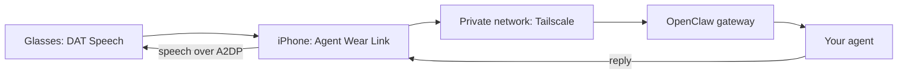

# Agent Wear Link (companion app)

**Talk to your own OpenClaw agent through Ray-Ban Meta glasses, without opening an app or keeping the phone screen on.**

[Docs home](../../docs/README.md) · [Research notes](../../docs/research/README.md) · [Meta DAT adapter](../../Adapters/MetaDAT/README.md)

> [!WARNING]
> Pre-alpha. The library pieces are covered by tests, but the hands-free and locked-phone behaviour described below has **not yet been validated on hardware**. Meta's Speech, Inputs and Voice Invocation capabilities are experimental. They can be used for development and beta channels only, so this app can't be published on the App Store today.

## What it is

The app is a **connection manager**, not a chat client. You set it up once, then put on the glasses and speak:

> "*Alfred*, recommend a café near here."

The request goes to your agent and the reply is spoken back on the glasses. The conversation history stays where your agent already keeps it, for example Telegram. Agent names in this README are examples: the app reads the real name from your gateway (`agent.identity.get`).



## Why not "Hey Meta, …"?

General "Hey Meta" requests always go to Meta AI. Meta staff confirm that a registered app cannot receive them ([research](../../docs/research/hey-meta-and-meta-ai-boundary.md)). The app therefore keeps its own Speech session and listens for **your agent's name**. Other ways in:

- **Double tap** on the glasses arms the next sentence without saying the name.
- **"Hey Meta, open Agent Wear Link"** (English only) starts the app if it isn't running.
- A **Shortcuts automation** can start it when the glasses connect over Bluetooth. Use the "Start listening in Agent Wear Link" action.

## Screens

| Screen | Purpose |
| --- | --- |
| Home | The five hops (glasses → phone → network → gateway → agent), each with when it was last checked. Glasses that are off or in the case show as *waiting*, not as an error. |
| Repair | The first broken hop, its likely causes, and one action. |
| Setup | Meta registration → microphone → Tailscale VPN On Demand → pair with the gateway → call practice. Shown once. |
| Settings | Listening, chat-channel delivery, short spoken answers, wake phrases, gateway name, device fingerprint, re-approve, reset, hidden diagnostics. |

## Pairing

On the gateway host, print a one-time setup code:

```bash
openclaw qr --url wss://<gateway-host>:<port>   # use --url when Tailscale Serve is configured manually
```

Scan the QR in the app, or paste the code. The code carries a short-lived bootstrap token, never the shared gateway token. The app then waits for approval. Compare the fingerprint shown in the app with the pending request:

```bash
openclaw devices list
openclaw devices approve <requestId>
```

After approval, the device grant is stored in the Keychain. Later launches and recoveries reconnect without any token.

## Staying connected without notifications

- Glasses folded, in the case or charging: the app waits quietly and reconnects when the glasses are available again.
- Gateway or network unreachable: it retries with backoff (5, 10, 30 and 60 s).
- Tapping **Disconnect** stops recovery until you connect again.
- After a reboot iOS doesn't relaunch apps by itself. Use the Shortcuts automation above or open the app once.

## Build

```bash
export DEVELOPER_DIR=/Applications/Xcode.app/Contents/Developer
cd Apps/Companion
../../.build/tools/xcodegen generate --spec project.yml        # run scripts/install-xcodegen.sh first if missing
xcodebuild -project AgentWearLinkCompanion.xcodeproj -scheme AgentWearLinkCompanion \
  -destination 'platform=iOS Simulator,name=iPhone 17' test
```

For a physical device, create an uncommitted `local.companion.xcconfig` next to `Companion.xcconfig`. It holds your team ID, callback URL scheme and bundle identifier, and the `local.*` rule in `.gitignore` keeps it out of git. `Companion.xcconfig` includes it, so it applies to Xcode and command-line builds alike:

```bash
xcodebuild -project AgentWearLinkCompanion.xcodeproj -scheme AgentWearLinkCompanion \
  -destination 'generic/platform=iOS' -allowProvisioningUpdates build
```

If you already have a provisioned app ID (for example from an earlier AgentWearLink host build), set `PRODUCT_BUNDLE_IDENTIFIER` to it. The app then installs as an update of that app and needs no new profile.

Meta AI Developer Mode needs no App ID or client token.

## Privacy

- No transcript text is written to the diagnostics log; only lengths and states are recorded. The live transcript is shown only on the call-practice screen.
- Tokens never go to UserDefaults or logs. Device grants live in the Keychain.
- The app doesn't send your location. Location-aware agents should use their own private channel (see [companion app constraints](../../docs/research/companion-app-constraints.md)).
