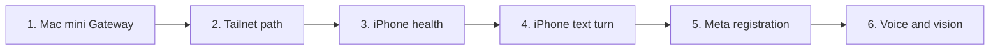

# Reference deployment: Ray-Ban Meta + iPhone + Mac mini + OpenClaw

This is the end-to-end order for bringing up the reference stack on real
devices. Each step links to the detailed runbook that owns its evidence. Run the
steps in order: each one removes a whole class of failure before the next, more
expensive step.



## 0. Prerequisites

| Item | Why | Owner action |
| --- | --- | --- |
| Xcode (not only Command Line Tools) with an iOS platform | XCTest, iOS builds, and on-device installs | Install from the App Store |
| Apple development team | Signing the reference host for a physical iPhone | Xcode → Settings → Accounts |
| Meta Wearables developer app | Meta App ID, Client Token, callback URL scheme, bundle ID | Register in Meta's developer console; see [P0-A](meta-dat-validation.md) |
| Meta AI app with Developer Mode, glasses paired | DAT registration and sessions | On the iPhone |
| Tailscale on the iPhone, same tailnet as the Mac | Private Gateway path | Tailscale app |
| iPhone Developer Mode | Installing a development build | iOS Settings → Privacy & Security |

## 1. Mac mini Gateway

- Check that the installed OpenClaw release speaks AWL's wire subset:

  ```bash
  python3 scripts/verify-openclaw-protocol-contract.py --commit <full sha of your release>
  ```

  See [protocol contract](openclaw-protocol-contract.md) for releases already checked.
- From the Mac itself, run the read-only [probe](openclaw-probe.md) over loopback,
  then one harmless [chat probe](openclaw-chat-probe.md) turn in a dedicated
  session key (not a chat channel's session).

## 2. Tailnet path

- Keep the Gateway bound to loopback, and serve it tailnet-only with Tailscale Serve. If port
  443 already carries a Funnel, use a separate port; see [Tailscale](tailscale.md).
- Confirm that the Gateway trusts the local proxy's forwarding headers, so a
  tailnet client is not treated as loopback and auto-paired.
- `tailscale serve status` should show the Gateway port as **tailnet only**.

## 3. iPhone health (no glasses)

Build the reference host (see [P0-A Phase 0](meta-dat-validation.md)). Then use
**Check Gateway health (read-only, no glasses)** with `<mac-mini>.ts.net[:port]`.

- The first attempt should report `gateway-health-pairing-required`.
- Approve that exact request on the Mac (`openclaw devices approve <requestId>`),
  then retry until you get `gateway-health-ok`.

Evidence goes to #56 and #117.

## 4. iPhone text turn

Follow the [P0-B runbook](p0b-openclaw-validation.md): a separate mutating identity,
its own approval, one harmless text turn, incremental text, one terminal, and no
replay after a network interruption. Evidence goes to #56, #97 and #118.

## 5. Meta registration and session

Follow [P0-A](meta-dat-validation.md): the official sample baseline first, then
AWL registration, session start/stop, link loss and recovery. Evidence goes to #1
and #98.

## 6. Voice and vision

- Hands-free voice invocation and speech round-trip: #6 and #5.
- Explicit photo → vision agent: #58.
- Reliability, privacy and recovery matrix: #59.

## Deployment notes

- **Background summary calls.** OpenClaw sessions can trigger background
  activity-recap calls on the agent's utility model in addition to the turn
  itself. These do not add to turn latency, but they do cost tokens. When
  `agents.defaults.utilityModel` is unset, OpenClaw picks the provider default. Set
  it to a small model, or to `""` to disable recaps; see OpenClaw's model
  documentation.
- **Secrets.** Never put the Gateway token in an xcconfig, plist, issue, or log.
  The reference host clears the token field after use.
