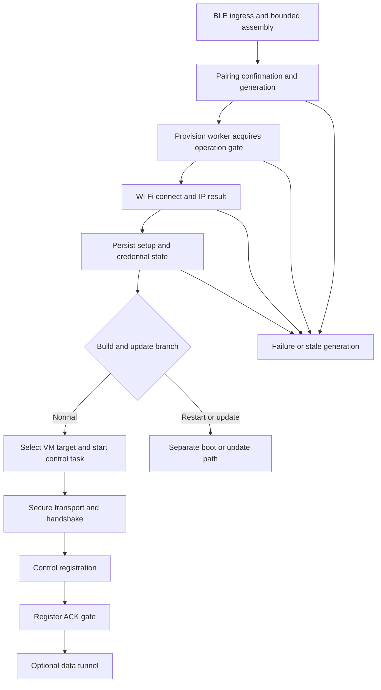
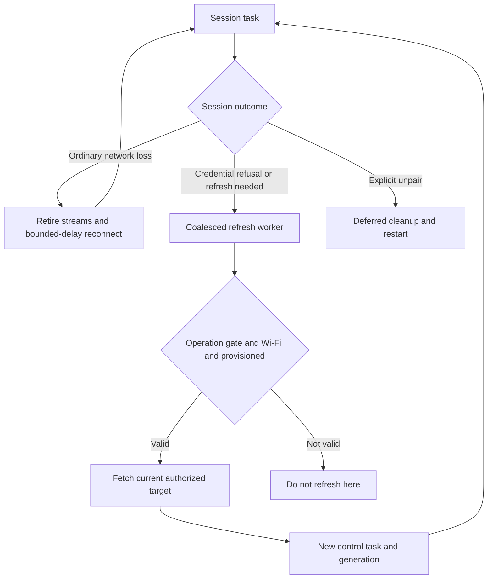

# Muse handover conformance and service-independence decision — 2026-11-25

This document reconciles #641 and #639 for the **reference-only, no-adoption** decision. #643 retains the broader 322-file audit and security/feature/test graph (203 initial records; 119 remaining); no blanket approval of the 1,096 upstream files. Firmware, actual radio/credential service and target-device behavior remain untested by AWL. No Muse integration is selected. Reopen the specific conformance/provenance gate if a real authorized adapter or copied file/dependency is proposed. This is a product-scope decision, not a legal or security certification.

## Reproducible source handover

All source links below are at [1b894f551e64416e2844452ec6056ec56d6a10f1](https://github.com/facebookincubator/muse-gadget-sdk/tree/1b894f551e64416e2844452ec6056ec56d6a10f1). Earlier [Linux handover](muse-linux-handover-audit-2026-11-25.md), [Main call paths](muse-esp32-main-audit-2026-11-25.md) and [residual review](muse-esp32-main-residual-audit-2026-11-25.md) remain evidence. Do not infer that every optional board/build follows the same path. The following diagrams are static observed transitions, not a log of a physical device or an integration recipe.

| Actual source calls and lines | Verified boundary |
| --- | --- |
| [BLE RX L603–646](https://github.com/facebookincubator/muse-gadget-sdk/blob/1b894f551e64416e2844452ec6056ec56d6a10f1/esp32/main/ble_server.c#L603-L646) -> [dispatch L312–492](https://github.com/facebookincubator/muse-gadget-sdk/blob/1b894f551e64416e2844452ec6056ec56d6a10f1/esp32/main/ble_server.c#L312-L492) -> [provision_task L159–188](https://github.com/facebookincubator/muse-gadget-sdk/blob/1b894f551e64416e2844452ec6056ec56d6a10f1/esp32/main/ble_server.c#L159-L188) | Receive access copies/dispatches and frees temporary input; sensitive setup admission distinct from connectivity. [TX L707–790](https://github.com/facebookincubator/muse-gadget-sdk/blob/1b894f551e64416e2844452ec6056ec56d6a10f1/esp32/main/ble_server.c#L707-L790) serializes sends, fences crypto-record generation; successful local send not peer ACK. |
| [link_pairing L918–1010](https://github.com/facebookincubator/muse-gadget-sdk/blob/1b894f551e64416e2844452ec6056ec56d6a10f1/esp32/main/link_pairing.c#L918-L1010) -> [on_provision L1160–1253](https://github.com/facebookincubator/muse-gadget-sdk/blob/1b894f551e64416e2844452ec6056ec56d6a10f1/esp32/main/app.c#L1160-L1253) | Logical generation changes through confirmation/provisioning; operation gate and checks before/after transitions. Stale queued callback before ownership must not wipe newer setup. |
| [wifi_mgr_connect L238–381](https://github.com/facebookincubator/muse-gadget-sdk/blob/1b894f551e64416e2844452ec6056ec56d6a10f1/esp32/main/wifi_mgr.c#L238-L381) / [event handler L151–195](https://github.com/facebookincubator/muse-gadget-sdk/blob/1b894f551e64416e2844452ec6056ec56d6a10f1/esp32/main/wifi_mgr.c#L151-L195) -> [app commit/cleanup L563–700](https://github.com/facebookincubator/muse-gadget-sdk/blob/1b894f551e64416e2844452ec6056ec56d6a10f1/esp32/main/app.c#L563-L700) | Initial association/IP outcome, post-association reconnect distinct; logical persistence and verified cleanup, not registration. OTA/PAIR_THEN_RESTART branches skip normal inline control startup; not tested on board. |
| [app credential/VM selection L876–1065](https://github.com/facebookincubator/muse-gadget-sdk/blob/1b894f551e64416e2844452ec6056ec56d6a10f1/esp32/main/app.c#L876-L1065) -> [noise_ctrl_connect L2522–2598](https://github.com/facebookincubator/muse-gadget-sdk/blob/1b894f551e64416e2844452ec6056ec56d6a10f1/esp32/main/noise_control.cpp#L2522-L2598) -> [run_session L2011–2150](https://github.com/facebookincubator/muse-gadget-sdk/blob/1b894f551e64416e2844452ec6056ec56d6a10f1/esp32/main/noise_control.cpp#L2011-L2150) | Start task success distinct from secure session, registration and application-level readiness. Selected target-bound credential; no actual credential used in AWL. |
| [registration handling L1928–1988](https://github.com/facebookincubator/muse-gadget-sdk/blob/1b894f551e64416e2844452ec6056ec56d6a10f1/esp32/main/noise_control.cpp#L1928-L1988) -> [tunnel gate L2178–2211](https://github.com/facebookincubator/muse-gadget-sdk/blob/1b894f551e64416e2844452ec6056ec56d6a10f1/esp32/main/noise_control.cpp#L2178-L2211) -> [tunnel L232–369](https://github.com/facebookincubator/muse-gadget-sdk/blob/1b894f551e64416e2844452ec6056ec56d6a10f1/esp32/main/noise_tunnel.cpp#L232-L369) | Control, typed ACK and separate tunnel state. Preserve earlier #664 observation: register/tunnel admission condition weaker than heartbeat success; AWL must require typed positive ACK. |
| [session teardown L2434–2492](https://github.com/facebookincubator/muse-gadget-sdk/blob/1b894f551e64416e2844452ec6056ec56d6a10f1/esp32/main/noise_control.cpp#L2434-L2492) -> [on_ws_control_status L2457–2505](https://github.com/facebookincubator/muse-gadget-sdk/blob/1b894f551e64416e2844452ec6056ec56d6a10f1/esp32/main/app.c#L2457-L2505) -> [refresh scheduling/worker L1067–1124](https://github.com/facebookincubator/muse-gadget-sdk/blob/1b894f551e64416e2844452ec6056ec56d6a10f1/esp32/main/app.c#L1067-L1124) | Session clears request owners and tunnel before reporting disconnect, separately reports authentication refusal/refresh-needed; coalesced refresh takes operation gate, requires Wi-Fi/pairing, fetches current target, starts new generation. Token rejection/rotation not ordinary network retry. |
| [async commands L830–906](https://github.com/facebookincubator/muse-gadget-sdk/blob/1b894f551e64416e2844452ec6056ec56d6a10f1/esp32/main/ble_commands.c#L830-L906) | Result generation fence does not itself authorize pre-execution side effects. Queue-full teardown/cancel, positive ACK and parser boundaries transferred as independent requirements to #635/#637/#664; no generic remote radio operations. |

## #641 exact executed evidence and scope disposition

- [#703 PR host job](https://github.com/JDeun/AgentWearLink/actions/runs/45584868567/job/139103784111), exact head aca6cfbbaeb821a602727e0f037acf640e55c2d6, success. Ubuntu 24.04; g++ 13.3.0; libmbedtls-dev 2.28.8-1; python3-cryptography 41.0.7-4ubuntu0.4. Three upstream core tests ran, no skips. Independent fixture logged ordered C++/Python reassembly both directions at 1, 4096, 65489 and 65506 bytes; duplicate/poison, order, malformed/poison, local capacity, count ceiling, Python expiry, synthetic handshake and three authenticated echoes (1, 257, 8192), tamper/poison persistence, all PASS. [Main rerun](https://github.com/JDeun/AgentWearLink/actions/runs/45585076490) completed successfully. These are actual host executions of firmware core, not ESP32 board tests.
- #704 extends the isolated harness with shared upstream pairing transcript/reference vectors, Linux pairing tests, camera registry/parser harness and deterministic bounded parser mutation corpus with ASan/UBSan for C++. These runs and package versions must be checked in the exact #704 job logs before closing. The corpus is not coverage-guided fuzzing, not branch-coverage measurement, not proof of security. No BLE, Wi-Fi, service, firmware flashing or real credential access.
- [Core audit](muse-noise-core-audit-2026-11-25.md) describes different reassembly policies. C++ one caller-owned logical assembly max 16 MiB; Python 16 pending assemblies and per-assembly max 16 MiB; theoretical aggregate logical payload ceiling is 256 MiB, not measured heap, actual per-assembly limit also constrained by chunk count. Python expiry is checked on decode, not a background clock. New test host scratch is 1 MiB, per fixture input capped, workflow/step timeouts; do not infer physical RAM, end-to-end throughput or latency.
- Supported in research scope: common ordered framing and synthetic cryptographic duplex, documented policy differences, exact pinned source handover graph and no-adoption decision. Unsupported/unverified: service-envelope interoperability for every type, production server trust/authorization, BLE/Wi-Fi/credential rotation on hardware, full caller/board feature matrix, arbitrary radio commands, Swift protocol parity, exhaustive fuzz/coverage. There is no selected Muse adapter, so no Swift Noise implementation is necessary. Real device and service validation is not marked done or required for the no-adoption choice. #643 retains the cross-file feature/test/security audit; #635/#637/#664 retain independent correctness requirements. Reopen #641 only with a concrete authorized adapter and specific new interoperability requirement, then require full endpoint/board/security evidence before enabling it.

## #639 no-import decision and service terms

The [official Gadget SDK Token Terms](https://gadgets.muse.ai/sdk-terms), checked 2026-11-25, sections 1–7, distinguish token service use from open-source code. Token use is personal/non-commercial with the user's own Muse account; at most 50 devices per token, restrictions on sale, public offering, promotion and other distribution without permission, data disclosure/minimization, no disabling/circumventing restrictions, revocable unsupported access. Section 7 separates Apache code rights from any token right. The [pinned upstream README](https://github.com/facebookincubator/muse-gadget-sdk/blob/1b894f551e64416e2844452ec6056ec56d6a10f1/README.md#L42-L88) also requires a token for pairing and enumerates third-party/asset exceptions. No token was acquired, requested, embedded or used. AWL's existing Meta DAT and OpenClaw contracts are separate; no claim that their terms or commercial distribution rights are approved.

**Selected upstream files proposed for production copying: zero. Selected Muse production direct and transitive dependencies: zero. Selected Muse service/VM/token dependency: none.** The [AWL root manifest](https://github.com/JDeun/AgentWearLink/blob/833d1d1f2191ff144588bab00f88a014ebd58712/Package.swift), [DAT adapter manifest](https://github.com/JDeun/AgentWearLink/blob/833d1d1f2191ff144588bab00f88a014ebd58712/Adapters/MetaDAT/Package.swift), [Companion manifest](https://github.com/JDeun/AgentWearLink/blob/833d1d1f2191ff144588bab00f88a014ebd58712/Apps/Companion/project.yml) and [test app manifest](https://github.com/JDeun/AgentWearLink/blob/833d1d1f2191ff144588bab00f88a014ebd58712/Adapters/MetaDAT/TestApp/project.yml) contain AWL targets and separately pinned Meta Wearables DAT; not Muse. At main 833d1d1f2191ff144588bab00f88a014ebd58712, the 238 tracked Sources/Apps/Adapters/root Package.swift blobs have zero exact SHA matches against all 1,096 upstream tracked blobs; no vendored native file matches, only AWL-authored test driver in Tools/MuseResearch. Exact blob checks do not detect modified/derived source. The new independence check repeats this narrow evidence and known marker check in CI. Offline host research temporarily checks out public pinned source and installs compiler dependencies; no distribution or runtime use. Log host versions, separate provenance, no blanket redistribution clearance.

Source notices found: Apache-2.0 on first-party reviewed files, MIT panel/board exceptions, BSD-2-Clause pixel font, BSD-3-Clause libvpx + PATENTS, CC0 minimp3, AOSP Apache decoder, optional x264 GPL/commercial, OFL font/icon and external media terms, avatar excluded from root license. See [Main residual](muse-esp32-main-residual-audit-2026-11-25.md), [mobile/video](muse-mobile-video-audit-2026-11-25.md), [Noise](muse-noise-core-audit-2026-11-25.md), [camera](muse-camera-audit-2026-11-25.md). A README listing is not per-file legal verification. The older all-blob provenance checklist is not claimed complete; inventory-only rows do not certify rights. #643 continues per-candidate provenance, reachability and test mapping; the broader all-blob due diligence and exact dependency/asset bill of materials remain a prerequisite if future copying/reuse is proposed, not a cleared shipping permission. For the original #639 proposed-copy scope, the inventory of approved imports is empty by explicit no-adoption decision, not because all files were licensed for reuse. If any upstream code/binary/asset, token/VM/backend or native library is proposed, reopen #639 with exact upstream file SHA, license/notices/patents, resolved transitive graph and applicable service permission before adoption.

No legal advice or certification. Maintain independent AWL code, use only general design lessons. No device or service side effects in this research.

## Final executed evidence and issue dispositions

[#704 exact host job](https://github.com/JDeun/AgentWearLink/actions/runs/45585809391/job/139106991319), PR head 9b3ae9491e320bf9d7906225de98167ed30e73de, all steps successful; merged f3b691f9e6ebfdf1d3654648b24b47c87cc07860. Ubuntu 24.04, g++ 13.3.0, libmbedtls-dev 2.28.8-1, python3-cryptography 41.0.7-4ubuntu0.4, python3-pytest 7.4.4-1. Exact pinned upstream checkout reverified.

| Executed check | Observed outcome |
| --- | --- |
| Upstream Noise Core host suite | 3 passed; 0 skipped |
| Independent C++/Python duplex, frame boundary and fault assertions | All passed again; see #703 detailed sizes and #704 job |
| Shared pairing vector file equality and firmware transcript / crypto reference tests | byte-identical files; 2 passed, 0 skipped (three fixture records, not three physical sessions) |
| Linux pairing state tests | 56 passed, 0 skipped |
| Camera registry + SSCMA parser host harness | 2 passed, 0 skipped; no real SPI or camera |
| Bounded mutation/truncation/random corpus | 346 inputs, maximum 64 bytes; both actual parsers completed; C++ instrumented ASan/UBSan, no reported sanitizer failure |
| C++ parser classifications | complete 158, partial 6, rejected 182 |
| Python parser classifications | complete 170, partial 6, rejected 170 |
| Host process peak RSS (single run, Linux ru_maxrss) | Python 24,956 KiB, child 24,820 KiB; not a firmware heap budget |
| Narrow production independence evidence | 238 production blobs vs 1,096 upstream blobs, zero identical hashes and zero known Muse markers |
| Other checks | #704 Swift Core and Documentation integrity success |

63 selected upstream test cases executed successfully, separately from independent fixture assertions and the 346-input corpus. Do not double-count prior CI runs. Classification differences are expected policy observations, not a complete differential compatibility guarantee; no semantic oracle for every mutated input, no coverage-guided fuzz or branch-coverage percentage. The actual common-subset handshake/framing and defined fault checks, reproducible source graph with explicit feature alternatives, bounded corpus evidence, and decision not to implement an unneeded Swift Noise client satisfy #641's current research decision. Real device/service handover is explicitly NOT attempted or declared complete; reopen for a concrete authorized Muse adapter. #643 retains comprehensive file-by-file and cross-file evidence, and #635/#637/#664 retain independent product correctness.

For #639, zero selected upstream imports and zero selected Muse runtime dependencies are the adoption inventory; official service restrictions documented, independent manifests and narrow exact-blob/marker checks executed. Complete the no-import decision, not a clearance for copying the 1,096-file upstream tree. The broad old all-blob due-diligence checklist is conditional on future reuse; the remaining 322-candidate provenance and graph audit stays #643. Any later actual reuse requires reopening #639 and a concrete resolved dependency/rights review. No Muse token, account, backend or production library use.

Both issues are eligible for closure **as research decisions only** after this evidence record is merged. This is not permission to close #643, hardware gates, or any independent implementation/physical test issue.
