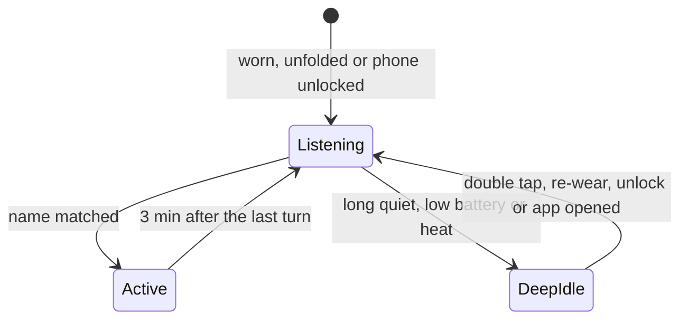

# Wake word and power

**How always-on wake words stay cheap elsewhere, why a DAT 1.0 app cannot do the same, and what AgentWearLink does instead.**

[Research notes](README.md) · [Glasses battery](glasses-battery.md) · [Hands-free speech](hands-free-speech.md)

## Summary

Every shipping wake word is a **cascade**. A tiny keyword detector runs all the time on a low-power core and keeps a short ring buffer. Only a candidate match wakes the main processor for a larger model, speaker checks and full speech recognition. DAT 1.0 gives third-party apps no such first stage. The only way to catch a custom name on the glasses is to run Speech, a full recogniser, all the time. That is two to three orders of magnitude more power than an industry first stage. An app can only shorten the always-on time, or borrow a first stage from somewhere else.

## Industry two-stage architecture

| Product | First stage and budget | Label |
| --- | --- | --- |
| Siri on iPhone | A small DNN on the Always On Processor scores audio; a high score wakes the main processor for a larger DNN. The first stage uses "a small proportion" of the AOP. A lower second threshold opens a few seconds of extra sensitivity ("second chance"). No power figure is published. | Verified: Apple ML Research, [Hey Siri (2017)](https://machinelearning.apple.com/research/hey-siri) |
| Siri on Apple Watch | One pass, run **only while the screen is on after a wrist raise**, using about 5% of the compute budget. It accepts a clipped start of the phrase. A cheap signal opens the window, and the detector runs only inside it. | Verified: same article |
| Siri (2023) | Four stages: an on-AOP detector with a ring buffer, a conformer on the main processor, speaker identification, then false-trigger mitigation on the whole utterance. It runs on iPhone, Watch, HomePod, AirPods, Mac and Vision Pro. | Verified: Apple ML Research, [Voice Trigger System for Siri](https://machinelearning.apple.com/research/voice-trigger) |
| Alexa (Echo) | On-device keyword spotting over a short, continuously overwritten buffer; nothing is sent before the wake word, which the cloud verifies again. | Verified: Amazon Alexa privacy FAQ |
| Google (Pixel Buds) | "Hey Google" hands-free with a connected phone. Where it is detected and its battery cost are not documented. | Verified: [Pixel Buds help](https://support.google.com/googlepixelbuds/answer/7560032?hl=en) |
| Bixby (Galaxy Buds Live) | Rated playback: 8 h with ANC and voice wake-up off, 6 h with one of them on, 5.5 h with both. The only public figure found for what an always-on wake word costs a wearable: about a quarter of playback time. | Reported: Samsung specification pages |
| Dedicated chips | A keyword-spotting chip listens at about 140 µW and interrupts the main system on a match. | Reported: Syntiant NDP100 announcements |
| "Hey Meta" | A system-owned path. Meta does not say where the wake word is detected. Third-party apps cannot receive general "Hey Meta" requests or change the wake word. | Verified: [Meta voice controls privacy notice](https://www.meta.com/legal/ai-glasses/voice-controls-privacy-notice/); [dat-android discussion #209](https://github.com/facebook/meta-wearables-dat-android/discussions/209) |

The lesson: no product runs a general recogniser all the time. The Apple Watch pattern, where a cheap signal opens a window and recognition runs only inside it, is the closest one a DAT app can copy.

## Why DAT 1.0 cannot do it

| Finding | Label |
| --- | --- |
| `Speech` has only `start()`, `stop()`, state, transcripts, errors and locale. It has no keyword, voice-activity or low-power option, and no pre-roll: speech before `start()` is never transcribed. | Verified: MWDATSpeech 1.0.0 public interface |
| "Run Speech only while your feature needs transcriptions to limit battery use." | Verified: [Wearables developer docs](https://wearables.developer.meta.com/docs/develop/dat/), "Transcribe speech on the glasses" |
| Voice invocation offers only `LaunchApp` ("Hey Meta, start <app>"), with no transcript. | Verified: MWDATCore 1.0.0 public interface |
| Continuous microphone use carries "battery and privacy trade-offs". Developers ask for a custom low-power wake word; none is offered. | Verified: Meta staff, [dat-android #153](https://github.com/facebook/meta-wearables-dat-android/issues/153). Reported: Android discussions [#69](https://github.com/facebook/meta-wearables-dat-android/discussions/69), [#85](https://github.com/facebook/meta-wearables-dat-android/discussions/85), [#96](https://github.com/facebook/meta-wearables-dat-android/discussions/96) |
| This project asked Meta for an app-registered wake phrase on the glasses' detector, a low-power voice-activity event, or "Hey Meta, ask <app> …" with the transcript. | [dat-ios discussion #343](https://github.com/facebook/meta-wearables-dat-ios/discussions/343) |
| The other glasses-side audio paths are no first stage either. The HFP microphone keeps a call-quality link open and degrades music. Camera-stream audio turns on the capture LED and stops A2DP playback. | Verified: Wearables docs (microphones and speakers); [dat-ios #256](https://github.com/facebook/meta-wearables-dat-ios/issues/256), [#318](https://github.com/facebook/meta-wearables-dat-ios/issues/318) |

## Measurements

| Measurement | Result | Label |
| --- | --- | --- |
| Session + Speech + Inputs listening continuously, silent keep-alive, Speech restarted about every 20 s | 94% to 79% in 18 min, about 50%/h | Observed here, single run ([glasses battery](glasses-battery.md)) |
| Speech in a quiet room | About 3 transcription events a second, all empty | Observed here |
| Speech after the glasses are put back on | Sometimes only empty transcripts while the wearer speaks; only `stop()` + `start()` recovers it | Observed here; the same behaviour is described in another project's code (see [other projects](other-projects.md)) |
| Rated continuous audio | Gen 2 about 5 h (about 20%/h), Gen 1 about 3 h | Reported: retailer pages, reviews |
| Speech `start()` to first transcript | Not published anywhere, not yet measured | Unverified |

Order of magnitude: a first-stage detector is around 0.1–1 mW; always-on Speech on the glasses is in the hundreds of milliwatts (Unverified: inferred from the measured drain and a reported battery capacity).

## Options ranked

| Rank | Option | Just say the name? | Glasses cost | Notes |
| --- | --- | --- | --- | --- |
| 1 | **Three modes** (proposed, below), with Speech restart backoff and respect for Speech stopping itself | Yes inside the listening window; double tap after it | Proportional to time spent listening | Follows Meta's advice directly. No effect on music, because Speech carries only text |
| 2 | **Glasses microphone over HFP, recognised on the phone** (experiment, off by default) | Yes | Mic and radio only; size unmeasured | Recognition runs on the iPhone (on-device `SFSpeechRecognizer`). No DAT session is opened alongside, because opening HFP next to a session ended sessions ([dat-ios #342](https://github.com/facebook/meta-wearables-dat-ios/issues/342)). Music becomes call quality while the mic is open. Phone battery cost unmeasured |
| 3 | Double tap (`.select(.captouch)`), then speak | No | Near zero | Already supported. An earcon confirms Speech has started |
| 4 | Siri App Shortcut "Siri, <app name>", Siri asks for the request | No (prefix and two turns) | Near zero; the phone's AOP listens | Siri can open the glasses' HFP during the turn; whether the DAT session survives is untested |
| 5 | "Hey Meta, start <app>", then speak | No | Near zero | English phrase; release channel needed; the link drops for a few seconds |
| Rejected | Speech duty cycle (n seconds on, n off) | Misses names said in the off part | — | No pre-roll |
| Rejected | Head-gesture wake from Motion | No | Needs a continuous sensor stream | Not a cheap first stage |
| Rejected | Camera-stream audio | Yes | Very high | Capture LED, stops music |

## Three modes

Proposed design, not implemented yet; the values are starting points for the A/B runs.

| Mode | Speech | What the wearer does | Ends when (initial values, to tune by A/B) |
| --- | --- | --- | --- |
| Active | Running | Follow-up questions without the name | 3 min after the last turn |
| Listening | Running, with restart backoff | Says the name and the request in one breath | 20 min without a match; battery at or below 30%; thermal at moderate or above |
| Deep idle | Stopped; session and Inputs kept | Double tap, re-wear or unlock first, then speak | A trigger above |

Taking the glasses off, folding them or severe heat already stops Speech. Because there is no pre-roll, a request in the same breath as a cheap trigger is lost, so a trigger opens the window and an earcon says when to speak.

## A/B plan

Thirty minutes each, same glasses, starting near 90%, phone locked, model and firmware recorded. Each run writes the power log.

1. Session + Inputs, Speech off, keep-alive off (the session's base cost)
2. 1 + keep-alive (the silent A2DP cost)
3. Speech on, restarts suppressed (always-on recognition)
4. 3 + 20 s restarts (restart churn)
5. 3 + backoff (the proposed listening mode)
6. HFP microphone open, no DAT session, music off (option 2's glasses cost)
7. Control: music through the glasses

Also measure Speech `start()` to first partial transcript (20 tries) and, for option 2, phone battery per hour and wake-word hit rate with the phone in hand, in a pocket and in a bag.
