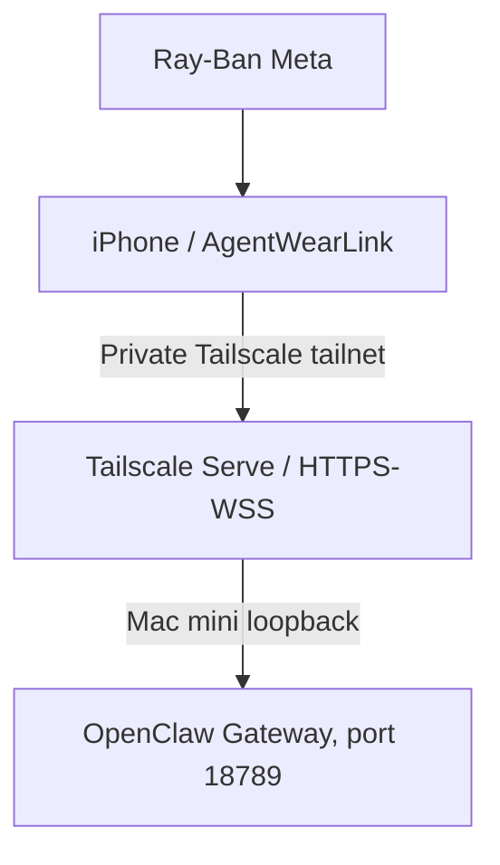

# Tailscale deployment profile

Tailscale is a deployment option, not an AgentWearLink core dependency.

## Recommended personal topology



## Preferred profile: Tailscale Serve

Keep the OpenClaw Gateway bound to loopback and let OpenClaw/Tailscale Serve expose a private tailnet-only HTTPS/WSS endpoint.

Conceptual OpenClaw configuration:

```json5
{
  gateway: {
    bind: "loopback",
    tailscale: { mode: "serve" }
  }
}
```

The iPhone client then uses the stable MagicDNS HTTPS/WSS hostname instead of a raw LAN address.

Advantages:

- Gateway port is not exposed on the LAN.
- TLS is terminated by Tailscale Serve.
- Stable MagicDNS hostname survives ordinary network changes.
- The phone can move between Wi-Fi and cellular while remaining on the tailnet.
- No public Funnel is required.

### When port 443 is already used by a Funnel

If the Mac already publishes something else on its MagicDNS name's port 443
(for example a chat webhook through Tailscale Funnel), do not move the Gateway
onto that public path. Serve the Gateway on a separate **tailnet-only** HTTPS
port instead, and leave the Funnel untouched:

```bash
tailscale serve --bg --https=8443 http://127.0.0.1:18789
tailscale serve status   # 443 stays "Funnel on"; 8443 shows "tailnet only"
```

The iOS reference host and `OpenClawEndpoint.tailnetServe(hostname:)` accept
`<mac-mini>.ts.net:8443`. A non-default port gets its own credential
namespace, so a pairing made for `:8443` is not reused for `:443`.

### Proxy trust and pairing

Through Serve, the Gateway sees the TCP connection coming from `127.0.0.1`.
Confirm that the Gateway trusts the local proxy's forwarding headers (OpenClaw
`gateway.trustedProxies` containing `127.0.0.1` and `::1`). Without that, a
proxied tailnet client can look like a loopback client, and a Gateway that
auto-approves local devices would pair it without the explicit approval step.
After the first iPhone connection, `openclaw devices list` should show a
**pending** request to approve rather than a device that is already paired.

## Alternative: direct Tailnet bind

OpenClaw can bind directly to the Tailnet interface and accept a connection such as:

```text
ws://<tailscale-ip>:18789
```

This is private to the tailnet but is a plain WebSocket transport. AWL supports this as an explicit deployment mode, but Serve/WSS is preferred when practical.

## Authentication

Tailnet reachability is not a replacement for application authorization.

AWL must support the OpenClaw authentication required by the selected Gateway path. Reusable secrets belong in iOS Keychain, never repository configuration.

Tailscale Serve identity-header authentication has path-specific semantics in OpenClaw. Do not assume it authenticates every HTTP API, node connection, or arbitrary reverse-proxy request.

## Reconnect behavior

Mobile network transitions are normal:

- Wi-Fi → cellular
- cellular → Wi-Fi
- Tailscale tunnel re-establishment
- Mac mini sleep/restart
- OpenClaw Gateway restart

The client must distinguish:

1. transport disconnected,
2. transport reconnecting,
3. Gateway connected but not authenticated,
4. authenticated and ready.

A request whose delivery/completion is uncertain must not be silently replayed after reconnect.

## Endpoint abstraction

AWL treats Tailscale as an endpoint/exposure profile. Core code does not import or depend on a Tailscale SDK.

Supported deployment categories:

- loopback/development
- direct Tailnet bind
- Tailscale Serve
- private reverse proxy

This keeps the OpenClaw adapter reusable for users who do not use Tailscale.
